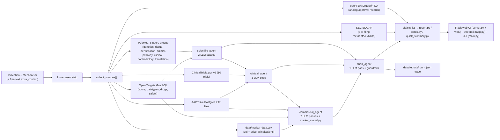

# Biotech AI Investment Committee — Code Audit & Improvement Plan

Scope: [hackathon_brief.txt](file:///c:/Users/User/Documents/GitHub/hackaton-unobio-track/plan/hackathon_brief.txt) vs. the whole repo. This document began as a read-only audit; it was updated on **2026-10-09** to reflect later code and commercial-diligence work. The original findings below are historical where marked; use the status updates and current gaps rather than treating every old observation as current.

## Current progress — 2026-10-09

| Plan item | Current status | What is now true / what remains |
|---|---|---|
| R3 / P1.2 — AACT | ⚠️ Partly verified | A local commercial run against the available flat-file source returned 27 KRAS G12C/NSCLC studies (17 active, 10 inactive). This makes the old “latest AACT = 0” observation stale for that run, but does not prove the live Postgres query or matching logic works across pairs. |
| R4 / R12 / P3.1 — regulatory & company sources | ⚠️ Partly closed | `pipeline.py` calls openFDA Drugs@FDA and SEC EDGAR; live checks returned a sotorasib approval/designation record and SEC 8-K filing records. openFDA is approval-analog precedent, not a complete Fast Track/Breakthrough register for a new asset. SEC returns filing metadata/exhibits, not sentiment or earnings-call transcripts. |
| R12 / P3.6 — patent source | ⚠️ Not integrated | `fetch_patentsview.py` is a USPTO ODP bulk-download helper, not a patent-search connector, and is not called by the pipeline. ODP returned 401 without a key. A preliminary KRAS G12C patent lead list is in `data/commercial_analysis_kras_g12c_nsclc.md`; this is not FTO. |
| R9 / P3.4 — commercial data integrity | ✅ Guardrail added; research incomplete | All 8 existing market-data rows are explicitly unverified. Code now requires a figure-specific evidence snippet and a verification flag before treating epidemiology/pricing as evidence. The values still need replacement or source-by-source validation; no automatic market-data source has been added. |
| R14 — cost accounting | ⚠️ Partly closed | Mixed-provider calls are now priced per provider instead of all at the first provider’s rate. Team-gateway price remains a zero placeholder; cached runs still need a “cost if uncached” display and traces still lack per-call/cache/timing detail. |
| R15 / P4.1 — documentation | ⚠️ Partly closed | README has an updated source/limitation section, but its opening still incorrectly describes Claude/Streamlit as the stack. Provider/UI descriptions conflict within the same file. Full English rewrite and UI language decision remain open. |
| L1 / P2.4 — card honesty | ⚠️ Partly closed | SEC card no longer promises sentiment analysis, and Patent & IP is explicitly labelled unconnected. Other mappings/cards have not been rebuilt against all 10 report sections. |
| Commercial diligence | ✅ Preliminary memo | `data/commercial_analysis_kras_g12c_nsclc.md` contains a dated public-source screen for KRAS G12C/NSCLC: patient-pool caveats, competitor trials, a dated adagrasib WAC reference, and patent leads. Asset-specific market sizing and FTO need the candidate profile and claim-level review. |

**Patent tool distinction:** use **Open Data Portal (ODP)** for patent search APIs, structured patent data, and bulk datasets. Use **Assignment Center** to search ownership/assignment transactions; it does not replace patent/application searching. ODP API automation needs a USPTO.gov account and an ODP API key (`USPTO_ODP_API_KEY`). Assignment Center is an additional ownership check, not a key needed for this pipeline.

---

# PART 1 — How the system works today

## 1.1 Flow

## 1.2 Key components

| Area | File(s) | What it does |
|---|---|---|
| Claim schema | [schema.py](file:///c:/Users/User/Documents/GitHub/hackaton-unobio-track/schema.py) | `Claim` dataclass: `evidence` (needs source) vs `inference` (needs reasoning and confidence). Section whitelist = the 10 "Required Output" sections. |
| Anti-hallucination | [agents/base.py](file:///c:/Users/User/Documents/GitHub/hackaton-unobio-track/agents/base.py) | Sources are labelled `S1..Sn`. An evidence claim must give `evidence_id` and a verbatim `exact_snippet`, checked against the raw text. Code then stamps `source/url/date`. `section` is forced by code. One retry on empty output. |
| LLM layer | [llm.py](file:///c:/Users/User/Documents/GitHub/hackaton-unobio-track/llm.py) | Provider chain: team gateway (gpt-6-luna) → Gemini → Claude. Disk cache keyed by hash of the prompts. Token and cost log. |
| Scientific agent | [agents/scientific_agent.py](file:///c:/Users/User/Documents/GitHub/hackaton-unobio-track/agents/scientific_agent.py) | Pass 1: scientific thesis (evidence tags, causal vs correlational, contradictory evidence, human vs animal). Pass 2: 5-link translation chain with explicit `MISSING LINK` claims. |
| Clinical agent | [agents/clinical_agent.py](file:///c:/Users/User/Documents/GitHub/hackaton-unobio-track/agents/clinical_agent.py) | Trial design, population, endpoints, comparator, size, sequence, PTRS, regulatory path, diligence gaps. |
| Commercial agent | [agents/commercial_agent.py](file:///c:/Users/User/Documents/GitHub/hackaton-unobio-track/agents/commercial_agent.py), [market_model.py](file:///c:/Users/User/Documents/GitHub/hackaton-unobio-track/market_model.py) | Pass 1: competitive landscape (stop_category logic). Pass 2: commercial opportunity. A deterministic patient funnel and peak sales run in pure Python (low/base/high). |
| Chair | [agents/chair_agent.py](file:///c:/Users/User/Documents/GitHub/hackaton-unobio-track/agents/chair_agent.py) | Produces only `inference` claims: recommendation (summary, rNPV, verdict), key_risks, capital_required, critical_unknowns, diligence_questions. Code guardrails: verdict normalisation, "Data Deficiency" and "High-Risk Override" downgrades, 5–10 diligence questions (unpack, dedupe, backfill, rank). |
| Sources | `sources/*.py` | PubMed (E-utilities, throttle, retry, cutoff), Open Targets, ClinicalTrials.gov, AACT (rich: roles, stop categories, direct competitors), commercial CSV with evidence-integrity checks. |
| Outputs | [report.py](file:///c:/Users/User/Documents/GitHub/hackaton-unobio-track/report.py), [cards.py](file:///c:/Users/User/Documents/GitHub/hackaton-unobio-track/cards.py), [quick_summary.py](file:///c:/Users/User/Documents/GitHub/hackaton-unobio-track/quick_summary.py), [raw_data.py](file:///c:/Users/User/Documents/GitHub/hackaton-unobio-track/raw_data.py) | Markdown report, 12-card web grid, "at a glance" summary, raw source dump. |
| Repro | [pipeline.py](file:///c:/Users/User/Documents/GitHub/hackaton-unobio-track/pipeline.py) | Writes a JSON trace per run: inputs, raw sources, claims, cost. |
| Demo | [demo_contradictory_case.py](file:///c:/Users/User/Documents/GitHub/hackaton-unobio-track/demo_contradictory_case.py) | Runs the same pair with and without an injected "Phase 3 failure + hepatotoxicity + FDA hold" text. |

---

# PART 2 — Requirements already met

| Brief requirement | Status | Notes |
|---|---|---|
| Input: Indication + Mechanism | ✅ | Streamlit and CLI. The web UI takes one box, split on `\|`, `for` or `in`. |
| Output has all 10 required sections + Sources | ✅ | `SECTION_TITLES` mirrors the brief verbatim. The Sources section is assembled by code. |
| Recommendation Invest / Conditional / Do Not Invest | ✅ | Normalised to exactly 3 values, with a default fallback. |
| Source evidence vs AI inference | ✅ (strong) | Structural, code-enforced. Verbatim snippet check, code-stamped metadata, hallucinated citations rejected. This is the best part of the system. |
| Actively search contradictory evidence | ✅ | Dedicated PubMed `contradictory` group. Prompt rules for a "no contradiction found" claim. |
| Correlation vs causal; human vs animal | ✅ (prompt-level) | Mandatory evidence tags and rules. Not structured data (see gaps). |
| Translation chain with missing links | ✅ | 5 mandatory links, `MISSING LINK:` claims feed the diligence questions. |
| Clinical plan: population, endpoint, comparator, size, sequence, PTRS | ✅ (prompt-level) | All inference, labelled as such. |
| Competition: same-target vs alternative; discontinued programs | ✅ (design), ⚠️ (coverage) | Strong AACT logic (`stop_category`, negated-safety regex). The old zero-result trace is not current for the flat-file run (27 records returned), but live DB and multi-pair matching still need verification. |
| Commercial: addressable patients, pricing, funnel, ranges | ✅ partly | Deterministic funnel with low/base/high and evidence-vs-inference tagging per parameter. |
| rNPV with ranges, not point estimates | ✅ partly | Low/Base/High. See the weak formula below. |
| "Scientifically interesting vs commercially valuable" | ✅ | Mandatory prompt item. |
| 5–10 diligence questions that need non-public data | ✅ (strong) | LLM + code guardrails + data-grounded backfill + discipline-balanced ranking. |
| Say "cannot be answered publicly" rather than inventing | ✅ | Explicit "Diligence Gaps" blocks in every agent. |
| Generalises across pairs | ⚠️ partly | Prompts are parameterised. Cached runs for 3 pairs exist (KRAS/NSCLC, BACE1/AD, PCSK9/hyperlipidemia). See hard-coded data below. |
| Drill-down Recommendation → Claims → Evidence → Sources | ⚠️ partly | Evidence → Source → URL works. Recommendation → Claims does **not** (no linkage). |
| README, architecture, source attribution, model/API usage, cost, traces | ⚠️ partly | README was updated for live providers, sources, and limitations; per-call trace/cost details and full English documentation remain incomplete. |
| Demo where new/contradictory evidence flips the conclusion | ⚠️ partly | Script exists. The latest trace shows "Do Not Invest" with sound reasoning. But the evidence is **user-typed, unsourced text**. |
| Graceful degradation | ✅ | Each agent is wrapped in `_safe_agent_call`. Fetchers return `None` instead of crashing. Raw data shows even if the LLM is down. |

---

# PART 3 — What is NOT met, and what is illogical

Severity: 🔴 hurts the score or demo directly · 🟠 important · 🟡 polish.

## 3.1 Brief requirements missing or weak

| # | Sev | Gap | Evidence in code |
|---|---|---|---|
| R1 | 🔴 | **Recommendation → Claims drill-down does not exist.** Claims have no ID and no `supports/derived_from` links. Chair claims cite no analyst claim. The UI shows verdict claims in a flat list. The brief's headline deliverable ("Interactive Evidence") is only half built. | `schema.Claim` has no `id`/`parents`. `chair_agent` never asks for them. `cards.build_verdict_claims` is a flat dump. |
| R2 | 🔴 | **Demo flip is not evidence-based.** `extra_context` is free text with no source. The brief wants "new or contradictory evidence". The system only "believes" the text. It isn't shown in the web UI either. | `demo_contradictory_case.py`. `server.py` ignores `extra_context`. |
| R3 | 🟠 | **AACT matching still needs systematic validation.** The old trace had 0 results, but the latest local commercial run read a flat-file dump and returned 27 KRAS G12C/NSCLC studies (17 active, 10 inactive). This is one positive case; live Postgres behavior and matching across three pairs are not established. | `sources/fetch_aact.py`; latest `python3 -m agents.test_local_run` run. |
| R4 | 🟠 | **Regulatory coverage is partial, not absent.** `pipeline.py` calls openFDA Drugs@FDA for analog drugs. It provides approval/submission metadata and recorded designations, but not a complete Fast Track/Breakthrough register for a new asset, nor FDA label/adverse-event coverage. SEC filing search is also wired for 8-K records; patent search is not. | `pipeline.py`, `sources/fetch_regulatory.py`, `sources/fetch_secedgar.py`; `fetch_patentsview.py` remains standalone. |
| R5 | ✅ | **Required sections come back empty or unstable.** Fixed: added missing `critical_unknowns` prompt rule, single-retry mechanism for missing sections, dropped claim audit logging, and resilient claim parsing. | `chair_agent.SYSTEM_PROMPT`, `chair_agent.chair_agent`, `schema.py`. |
| R6 | ✅ | **Capital / rNPV math is done by the LLM.** Fixed: implemented deterministic DCF WACC modeling in `financials.py`, passing numbers to chair, chair explains rather than invents valuations. | `financials.py`, `chair_agent.py`, `test_financials_unit.py`. |
| R7 | ✅ | **Risk ranking by probability × impact is not computed.** Fixed: `Claim` contains structured fields (`probability`, `impact_musd`, `impact_pct`, `risk_score`). `schema.parse_claims` normalizes numbers/percentages and provides text fallback. Chair computes `risk_score = probability * impact`, sorts `key_risks` strictly descending, and applies guardrails from numbers, not string markers. | `schema.py`, `chair_agent.py`, `report.py`, `test_structured_risks.py`. |
| R8 | 🟠 | **No dedicated "Disease and Unmet Need" step** (pipeline step 1: population, SoC, subgroups, clinically meaningful outcomes). README admits it is folded into commercial. Sources for SoC are only a CSV and an LLM. No guideline/literature search. | `README.md` note. `SYSTEM_PROMPT_COMMERCIAL` item 1. |
| R9 | 🟠 | **Hard-coded data still limits generality, and existing values are unverified.** `market_data.csv` holds 8 indications; every row is now flagged unverified because the provided URL/year did not establish that it supports the exact figure/region. `pricing_data.csv` is still referenced but absent. Other diseases lack curated inputs. | `fetch_commercial.py`, `data/market_data.csv`, `data/commercial_todo.md`. |
| R10 | 🟠 | **Input handling is fragile for non-KRAS-style mechanisms.** Target resolution uses the first word of the mechanism ("GLP-1 receptor agonist" → "GLP-1"). There is no parsing of target vs modality vs class. Optional inputs (modality, stage, preclinical results, biomarkers, route) are only one free-text box, and absent in the web UI. | `fetch_opentargets._resolve_entity`. `server.split_query`. |
| R11 | 🟠 | **Evidence quality is not structured.** `[human genetics]`/`[animal model]` are text prefixes. Causal vs correlational and evidence strength (e.g. a graded level) are not fields, so the UI cannot filter or summarise "N causal human-genetics claims". | Scientific prompt. |
| R12 | 🟠 | **Source coverage is still incomplete, but broader than the original audit.** PubMed, Open Targets, CT.gov, AACT, CSV market inputs, openFDA Drugs@FDA (analog approval metadata), and SEC EDGAR 8-K filing search are in the pipeline. Missing or limited: GWAS Catalog, UniProt/Reactome, preprints, adverse-event/label integration, automated patent search, and validated pricing sources. ODP bulk helper is not wired as a search connector. | `pipeline.collect_sources`, `sources/fetch_regulatory.py`, `sources/fetch_secedgar.py`, `sources/fetch_patentsview.py`. |
| R13 | 🟠 | **Capital to next milestone is a guess.** The "$50k–150k/patient" is in the prompt. AACT median enrollment exists but is not used to compute cost. No deterministic cost model, and no explicit "value inflection points" or "licensing/M&A outcomes" structure. | `clinical_agent` prompt item 5. |
| R14 | 🟠 | **Reproducible-pipeline deliverables remain incomplete.** Mixed-provider cost is now calculated at each provider's rate instead of the first model's rate. Trace still lacks per-call provider/cost, cache-hit flags, rejected-claim log, and per-stage timing. Cached re-runs still hide uncached cost; team-gateway price is still a 0.0 placeholder. | `llm.get_usage_summary`, `pipeline._write_trace`, `PRICE_OPENAI_* = 0.0`. |
| R15 | 🟠 | **README is still internally inconsistent.** A new section reflects connected sources and limitations, but the opening architecture still says Claude/Streamlit while `llm.py` supports TEAM gateway → Gemini → Claude and Flask also serves the web UI. Full English rewrite, accurate runbook/demo checklist, and UI/report language decision remain open. | `README.md`, `llm.py`, `server.py`, `app.py`. |
| R16 | 🟡 | **Evidence check is lexical only.** The quote must exist in the source, but nothing checks that the claim is *supported* by the quote. | `verify_exact_snippet`. |
| R17 | 🟡 | **No automated tests.** Only a manual bug report and two stray scripts. | `agents/test_*.py` are not a test suite. |

## 3.2 Things that look illogical

| # | Sev | Issue |
|---|---|---|
| L1 | 🟠 | **Card mapping still needs a design pass, but source honesty improved.** SEC card is now labelled as company disclosures rather than sentiment; Patent & IP says it is not connected. The unmet-need and manufacturing mappings remain questionable, and the grid still does not map cleanly to the 10 brief sections. | `cards.py`, `raw_data.py` |
| L2 | ✅ | **Positional-argument hacks between pipeline and agents.** Fixed: removed `isinstance` swaps in `scientific_agent` and `commercial_agent`. Unified analyst agent signatures with explicit keywords (`indication`, `mechanism`, `sources`, `extra_context`, `valid_sources`, `cutoff_date`). `pipeline.py` passes all arguments by keyword. | `pipeline.py`, `scientific_agent.py`, `commercial_agent.py`, `clinical_agent.py`. |
| L3 | 🟠 | **`cutoff_date` (time-travel) is fully built but unreachable.** Implemented in PubMed, AACT, Open Targets, agents and market data. `run_pipeline`, the server and the UI never expose it. This would be the best honest "evidence changes the conclusion" demo. |
| L4 | 🟠 | **Verdict can be driven by unsourced injected text**, and the chair gets `extra_context` as ground truth. Nothing labels it as "user-provided, unverified". |
| L5 | 🟠 | **Duplicated validation logic** in `schema.parse_claims` (unused for agents now) and `base.validate_and_build_claims`. The chair uses the weaker one. `Claim` also lacks the `evidence_id`/`based_on` fields that code attaches dynamically. |
| L6 | 🟠 | **Pipeline is fully synchronous and slow.** PubMed does 8 serial throttled queries, then 6 LLM calls, inside one HTTP request. No progress feedback, no timeout handling. `_usage_log` is a module global and `threaded=True`, so two simultaneous runs mix their cost. |
| L7 | 🟡 | **Scoring heuristics are over-engineered and inconsistent.** Diligence-question scoring is a pile of keyword lists with magic numbers. `_classify_question_discipline` uses `"ind"` as a keyword, which matches many words. |
| L8 | 🟡 | **Dead / stray files**: `generate_executive_summary`, `render_underwriting_report`, unused imports in `pipeline.py`, `run_commercial_analysis` (hard-coded 5/10/20% shares), root `commercial_agent_output.json`, `BACE1+.md`, `pcsk9.md`, `KRAS G12C_lung_cancer.md`, `data/commercial_todo.md` (broken encoding), `agents/test_*.py`. |
| L9 | 🟡 | **`.gitignore` has `*.txt` and `cache/*.json`.** A fresh clone has **no cached demo data**, so "cached answers for the live pair" lives only on one laptop. New `.txt` data files are silently ignored. |
| L10 | 🟡 | **Language mix.** Code comments, README, Streamlit title and demo script are Ukrainian. The report and prompts are English. Judges and users will see a mixed product. |
| L11 | 🟡 | **Fallback diligence questions are templates.** Fine as a safety net, but they can look generic across runs. |

---

# PART 4 — Improvement plan

Ordered by value for the final score. Effort: S ≤ 1 h, M = 2–4 h, L = ½–1 day.

## Phase 1 — Fix what breaks the demo (do first)

| ID | Task | Fixes | Effort |
|---|---|---|---|
| P1.1 | **Chair completeness.** Add the missing `critical_unknowns` bullet to the chair prompt. After parsing, check that all required sections exist. If one is missing, re-ask only for the missing sections (one retry). Log every dropped claim, with reason, into the trace. Make `parse_claims` tolerate extra keys. | R5 | ✅ Done |
| P1.2 | **Repair AACT matching.** Search by Open Targets drug names and target symbol/synonyms, not the raw mechanism string. Keep the title search as a fallback. Test on 3 pairs. Add a visible "AACT unavailable / 0 trials" note. | R3 | ✅ Done |
| P1.3 | **Deterministic financials** (`financials.py`). Take peak sales from `market_model`, PTRS per phase as structured fields from the clinical agent, a capital model (enrollment × cost/patient × phases, from AACT medians), and timeline. Compute the rNPV low/base/high in code with a time-value discount. The chair only *explains* the numbers. | R6, R13 | ✅ Done |
| P1.4 | **Structured risks.** The chair returns `probability` (0–1) and `impact_musd` (or % of rNPV) as fields. Code ranks by product and applies the override from numbers, not text markers. | R7 | ✅ Done |
| P1.5 | **Fix positional-arg hacks**: pass everything by keyword, remove the `isinstance` swaps. | L2 | ✅ Done |

## Phase 2 — Interactive Evidence and the demo

| ID | Task | Fixes | Effort |
|---|---|---|---|
| P2.1 | **Claim graph.** Add `id` and `supports: [claim ids]` to `Claim`. The chair prompt must cite analyst claim IDs. Validate that IDs exist. UI: click verdict → supporting claims → quote → source link. | R1 | L |
| P2.2 | **Evidence-based flip demo.** Expose `cutoff_date` in `run_pipeline`, the server and the UI ("evidence as of date"). Pick one pair with a real before/after (e.g. an approval, safety signal or failed trial). Show the two verdicts side by side. Keep the injected-text mode but mark it "user-provided, unverified" and have the chair label it so. | R2, L3, L4 | M |
| P2.3 | **Web UI inputs.** Add structured optional fields (modality, stage, preclinical, biomarkers, route) in the UI and API. Show the cost, trace link and model used. | R10 | M |
| P2.4 | **Finish the card-grid review.** ✅ SEC card description and Patent & IP disconnected-state label corrected. Still fix the unmet-need/manufacturing mappings and align the remaining cards with the brief's sections. | L1 | M |
| P2.5 | **Progress and async.** Run the pipeline in a background job, stream stage status (sources → science → clinical → commercial → chair). Isolate per-run usage logs. | L6 | M |

## Phase 3 — Evidence depth and generality

| ID | Task | Fixes | Effort |
|---|---|---|---|
| P3.1 | **Extend regulatory coverage.** ✅ openFDA Drugs@FDA analog approval/submission records are in `collect_sources`; ✅ SEC EDGAR 8-K metadata is in raw data. Still add FDA label/adverse-event evidence where appropriate, feed regulatory evidence to the clinical agent, and keep unsupported pathway claims labelled inference. | R4, R12 | M |
| P3.2 | **Disease & unmet-need step.** A short dedicated pass: PubMed search for guidelines/SoC/outcomes, output patient population, SoC, subgroups, meaningful outcomes. Feed into commercial. | R8 | M |
| P3.3 | **Input normaliser.** An LLM or rule step turns "mechanism" into `{target, modality, class}` and resolves the disease via Open Targets/EFO. Show the resolved entities to the user. | R10 | M |
| P3.4 | **Make commercial data safe and general.** ✅ CSV values without exact support are now blocked from evidence claims. Replace or validate the eight legacy rows with source-specific snippets; for missing data, report unknown or clearly labelled low-confidence inference rather than presenting LLM estimates as observed facts. Create a validated pricing source/table or remove the dead `pricing_data.csv` reference. | R9 | S–M |
| P3.5 | **Structured evidence quality.** Add `evidence_class` (human_genetics, human_tissue, animal, in_vitro, clinical, review) and `causality` (causal / correlational / unclear) fields. Show a small summary on the scientific card. | R11 | M |
| P3.6 | **Optional sources** (only if time): GWAS Catalog, bioRxiv, Reactome. For patents, replace the standalone ODP bulk downloader with a searchable ODP patent API connector and connect results to the card. Get `USPTO_ODP_API_KEY` from a USPTO.gov account. Use Assignment Center separately to check assignment/ownership records; it is not the patent-search API. | R12 | M each |
| P3.7 | **Semantic support check** (cheap NLI/LLM yes/no) for evidence claim vs quote. | R16 | M |

## Phase 4 — Deliverables and hygiene

| ID | Task | Fixes | Effort |
|---|---|---|---|
| P4.1 | **README rewrite (English).** ⚠️ Partly done: source coverage and limitations were added, but the opening still has stale Claude/Streamlit claims. Correct the conflicting stack description, then add a current architecture diagram, verified setup/demo instructions, source-attribution table, cost caveats, and settle language consistency. | R15, L10 | M |
| P4.2 | **Richer traces.** Per-stage timing, per-call model/tokens/cost, cache hit flag, rejected claims with reason, prompts hash. Real cost reported even for cached re-runs ("cost if uncached"). Set real gateway prices. | R14 | M |
| P4.3 | **Commit demo cache.** Move 2–3 demo pairs to a tracked `demo_cache/` and add a "replay" mode. Fix `.gitignore` so it doesn't hide `*.txt` data. | L9 | S |
| P4.4 | **Tests.** `pytest` for `schema`, `base.verify_exact_snippet`, `market_model`, the chair guardrails, the financial model. One smoke test on a cached pair. | R17 | M |
| P4.5 | **Cleanup.** Remove or move dead code and stray `.md`/`.json` outputs. Consolidate to one validator. Pick one UI as main (web) and keep Streamlit only if maintained. | L5, L7, L8 | S |
| P4.6 | **Test on 3+ different pairs** (oncology, CNS, metabolic/rare) after Phases 1–3. Save the traces. Record a backup demo video. | brief | M |

## Suggested order for a short time budget
1. Get USPTO ODP access if automated patent search is in scope; implement search and connect it to the IP card. Assignment Center is a separate ownership/assignment check.
2. Validate AACT live DB and matching on three pairs; the flat-file KRAS G12C run is positive but not sufficient.
3. Verify commercial population and pricing inputs with exact primary-source snippets; build a disease/unmet-need evidence step.
4. P1.1 + P1.3 + P1.4 (chair completeness, defensible financials, structured risk ranking).
5. P2.1 + P2.2 (claim graph and evidence-based demo flip).
6. P4.1 + P4.2 + P4.4 (README, traces, automated tests).

---

# Open questions for you

1. **Primary UI:** keep the Flask web UI as the demo UI and freeze Streamlit?
2. **Demo pair for the "evidence flips the verdict" case:** do you already have one? If not, I can propose a candidate with a real date-based before/after.
3. **Scope of new sources:** openFDA and SEC are already connected in limited form. Should the next integration priority be automated USPTO ODP patent search, GWAS Catalog, or both? (ODP key required only for the automated patent API.)
4. **Language:** should the README and UI be switched fully to English?
5. **Financial model:** is a simple time-discounted rNPV acceptable, or do you want a Monte Carlo range?
