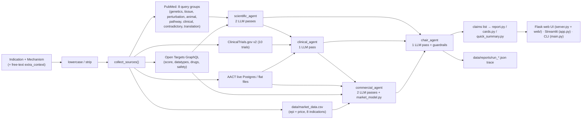

# Biotech AI Investment Committee — Code Audit & Improvement Plan

Scope: [hackathon_brief.txt](file:///c:/Users/User/Documents/GitHub/hackaton-unobio-track/plan/hackathon_brief.txt) vs. the whole repo. No code was changed. The traces in `data/reports/` (2 runs, NSCLC × KRAS G12C) were inspected to check what the system actually produces. The LLM chain has not been run again live.

---

# PART 1 — How the system works today

## 1.1 Flow

## 1.2 Key components

| Area | File(s) | What it does |
|---|---|---|
| Claim schema | [schema.py](file:///c:/Users/User/Documents/GitHub/hackaton-unobio-track/schema.py) | `Claim` dataclass: `evidence` (needs source) vs `inference` (needs reasoning and confidence). Section whitelist = the 10 "Required Output" sections. |
| Anti-hallucination | [agents/base.py](file:///c:/Users/User/Documents/GitHub/hackaton-unobio-track/agents/base.py) | Sources are labelled `S1..Sn`. An evidence claim must give `evidence_id` and a verbatim `exact_snippet`, checked against the raw text. Code then stamps `source/url/date`. `section` is forced by code. One retry on empty output. |
| LLM layer | [llm.py](file:///c:/Users/User/Documents/GitHub/hackaton-unobio-track/llm.py) | Provider chain: team gateway (gpt-6-luna) → Gemini → Claude. Disk cache keyed by hash of the prompts. Token and cost log. |
| Scientific agent | [agents/scientific_agent.py](file:///c:/Users/User/Documents/GitHub/hackaton-unobio-track/agents/scientific_agent.py) | Pass 1: scientific thesis (evidence tags, causal vs correlational, contradictory evidence, human vs animal). Pass 2: 5-link translation chain with explicit `MISSING LINK` claims. |
| Clinical agent | [agents/clinical_agent.py](file:///c:/Users/User/Documents/GitHub/hackaton-unobio-track/agents/clinical_agent.py) | Trial design, population, endpoints, comparator, size, sequence, PTRS, regulatory path, diligence gaps. |
| Commercial agent | [agents/commercial_agent.py](file:///c:/Users/User/Documents/GitHub/hackaton-unobio-track/agents/commercial_agent.py), [market_model.py](file:///c:/Users/User/Documents/GitHub/hackaton-unobio-track/market_model.py) | Pass 1: competitive landscape (stop_category logic). Pass 2: commercial opportunity. A deterministic patient funnel and peak sales run in pure Python (low/base/high). |
| Chair | [agents/chair_agent.py](file:///c:/Users/User/Documents/GitHub/hackaton-unobio-track/agents/chair_agent.py) | Produces only `inference` claims: recommendation (summary, rNPV, verdict), key_risks, capital_required, critical_unknowns, diligence_questions. Code guardrails: verdict normalisation, "Data Deficiency" and "High-Risk Override" downgrades, 5–10 diligence questions (unpack, dedupe, backfill, rank). |
| Sources | `sources/*.py` | PubMed (E-utilities, throttle, retry, cutoff), Open Targets, ClinicalTrials.gov, AACT (rich: roles, stop categories, direct competitors), commercial CSV with evidence-integrity checks. |
| Outputs | [report.py](file:///c:/Users/User/Documents/GitHub/hackaton-unobio-track/report.py), [cards.py](file:///c:/Users/User/Documents/GitHub/hackaton-unobio-track/cards.py), [quick_summary.py](file:///c:/Users/User/Documents/GitHub/hackaton-unobio-track/quick_summary.py), [raw_data.py](file:///c:/Users/User/Documents/GitHub/hackaton-unobio-track/raw_data.py) | Markdown report, 12-card web grid, "at a glance" summary, raw source dump. |
| Repro | [pipeline.py](file:///c:/Users/User/Documents/GitHub/hackaton-unobio-track/pipeline.py) | Writes a JSON trace per run: inputs, raw sources, claims, cost. |
| Demo | [demo_contradictory_case.py](file:///c:/Users/User/Documents/GitHub/hackaton-unobio-track/demo_contradictory_case.py) | Runs the same pair with and without an injected "Phase 3 failure + hepatotoxicity + FDA hold" text. |

---

# PART 2 — Requirements already met

| Brief requirement | Status | Notes |
|---|---|---|
| Input: Indication + Mechanism | ✅ | Streamlit and CLI. The web UI takes one box, split on `\|`, `for` or `in`. |
| Output has all 10 required sections + Sources | ✅ | `SECTION_TITLES` mirrors the brief verbatim. The Sources section is assembled by code. |
| Recommendation Invest / Conditional / Do Not Invest | ✅ | Normalised to exactly 3 values, with a default fallback. |
| Source evidence vs AI inference | ✅ (strong) | Structural, code-enforced. Verbatim snippet check, code-stamped metadata, hallucinated citations rejected. This is the best part of the system. |
| Actively search contradictory evidence | ✅ | Dedicated PubMed `contradictory` group. Prompt rules for a "no contradiction found" claim. |
| Correlation vs causal; human vs animal | ✅ (prompt-level) | Mandatory evidence tags and rules. Not structured data (see gaps). |
| Translation chain with missing links | ✅ | 5 mandatory links, `MISSING LINK:` claims feed the diligence questions. |
| Clinical plan: population, endpoint, comparator, size, sequence, PTRS | ✅ (prompt-level) | All inference, labelled as such. |
| Competition: same-target vs alternative; discontinued programs | ✅ (design) | Strong AACT logic (`stop_category`, negated-safety regex). **But see AACT = 0 records below.** |
| Commercial: addressable patients, pricing, funnel, ranges | ✅ partly | Deterministic funnel with low/base/high and evidence-vs-inference tagging per parameter. |
| rNPV with ranges, not point estimates | ✅ partly | Low/Base/High. See the weak formula below. |
| "Scientifically interesting vs commercially valuable" | ✅ | Mandatory prompt item. |
| 5–10 diligence questions that need non-public data | ✅ (strong) | LLM + code guardrails + data-grounded backfill + discipline-balanced ranking. |
| Say "cannot be answered publicly" rather than inventing | ✅ | Explicit "Diligence Gaps" blocks in every agent. |
| Generalises across pairs | ⚠️ partly | Prompts are parameterised. Cached runs for 3 pairs exist (KRAS/NSCLC, BACE1/AD, PCSK9/hyperlipidemia). See hard-coded data below. |
| Drill-down Recommendation → Claims → Evidence → Sources | ⚠️ partly | Evidence → Source → URL works. Recommendation → Claims does **not** (no linkage). |
| README, architecture, source attribution, model/API usage, cost, traces | ⚠️ partly | Exist, but stale and incomplete. See gaps. |
| Demo where new/contradictory evidence flips the conclusion | ⚠️ partly | Script exists. The latest trace shows "Do Not Invest" with sound reasoning. But the evidence is **user-typed, unsourced text**. |
| Graceful degradation | ✅ | Each agent is wrapped in `_safe_agent_call`. Fetchers return `None` instead of crashing. Raw data shows even if the LLM is down. |

---

# PART 3 — What is NOT met, and what is illogical

Severity: 🔴 hurts the score or demo directly · 🟠 important · 🟡 polish.

## 3.1 Brief requirements missing or weak

| # | Sev | Gap | Evidence in code |
|---|---|---|---|
| R1 | 🔴 | **Recommendation → Claims drill-down does not exist.** Claims have no ID and no `supports/derived_from` links. Chair claims cite no analyst claim. The UI shows verdict claims in a flat list. The brief's headline deliverable ("Interactive Evidence") is only half built. | `schema.Claim` has no `id`/`parents`. `chair_agent` never asks for them. `cards.build_verdict_claims` is a flat dump. |
| R2 | 🔴 | **Demo flip is not evidence-based.** `extra_context` is free text with no source. The brief wants "new or contradictory evidence". The system only "believes" the text. It isn't shown in the web UI either. | `demo_contradictory_case.py`. `server.py` ignores `extra_context`. |
| R3 | 🔴 | **AACT returned 0 records in the latest run**, so Competitive and Regulatory cards are nearly empty. Cause (code): AACT searches `intervention ILIKE '%kras g12c inhibitor%'` or the title. Real trials list drug names (sotorasib, adagrasib) and titles rarely contain the word "inhibitor". The same-mechanism drug list from Open Targets is not used to *find* the trials. Possible second cause: DB creds or connectivity. `BUG_TEST_REPORT` only tested pembrolizumab. | `sources/fetch_aact.py` `_build_live_sql`. Latest trace: `aact: 0`. No `aact_*.json` in `cache/`. |
| R4 | 🔴 | **The "regulations" dimension has no source at all.** The brief lists FDA/EMA documents. Regulatory path is pure LLM knowledge. The openFDA, CMS and PatentsView fetchers were written but are **never called**. | `sources/fetch_openfda.py`, `fetch_cms.py`, `fetch_patentsview.py` have no importers. |
| R5 | 🔴 | **Required sections come back empty or unstable.** The latest-but-one trace had **no `key_risks` and no `capital_required`**. **`critical_unknowns` is empty in both traces.** Cause: the chair prompt says "exactly these five values" but only describes four. `critical_unknowns` is never requested. `parse_claims` silently drops any claim with an unexpected key (e.g. `based_on`). No required-section check or retry exists. | `chair_agent.SYSTEM_PROMPT` (4 bullets). `schema.parse_claims` (`except … continue`). |
| R6 | 🔴 | **Capital / rNPV math is done by the LLM.** The brief asks for transparent assumptions. The chair must do `PTRS × PeakSales − Capital` in prose. PTRS is only text from the clinical agent. The deterministic `market_model` peak sales are not passed to the chair as numbers. The formula is not a real rNPV (no timing, discounting, COGS or cost-to-launch). | `chair_agent` prompt. `market_model.py` result is only turned into a text claim. |
| R7 | 🟠 | **Risk ranking by probability × impact is not computed.** Probability and impact exist only inside free-text `reasoning`. The override guardrail detects "high" with string markers (`"60%"`, `"critical"`, `"loss"`) and looks only at `key_risks[0]`. This is fragile and can be wrong in both directions. | `_enforce_risk_override_guardrail`. |
| R8 | 🟠 | **No dedicated "Disease and Unmet Need" step** (pipeline step 1: population, SoC, subgroups, clinically meaningful outcomes). README admits it is folded into commercial. Sources for SoC are only a CSV and an LLM. No guideline/literature search. | `README.md` note. `SYSTEM_PROMPT_COMMERCIAL` item 1. |
| R9 | 🟠 | **Hard-coded data limits generality.** `market_data.csv` holds only 8 indications. `pricing_data.csv` is referenced but does not exist. `INDICATION_SYNONYMS` is a hand-written list. For any other disease, commercial inputs are `None` and the funnel falls back to LLM guesses. This conflicts with "should work for any drug, disease, or mechanism". | `fetch_commercial.py`, `data/`. |
| R10 | 🟠 | **Input handling is fragile for non-KRAS-style mechanisms.** Target resolution uses the first word of the mechanism ("GLP-1 receptor agonist" → "GLP-1"). There is no parsing of target vs modality vs class. Optional inputs (modality, stage, preclinical results, biomarkers, route) are only one free-text box, and absent in the web UI. | `fetch_opentargets._resolve_entity`. `server.split_query`. |
| R11 | 🟠 | **Evidence quality is not structured.** `[human genetics]`/`[animal model]` are text prefixes. Causal vs correlational and evidence strength (e.g. a graded level) are not fields, so the UI cannot filter or summarise "N causal human-genetics claims". | Scientific prompt. |
| R12 | 🟠 | **Source coverage is thin vs the brief's list.** Only PubMed (abstracts), Open Targets, CT.gov, AACT. Missing: GWAS Catalog, UniProt/Reactome, bioRxiv/medRxiv, FDA labels/approvals, patents, company filings, pricing sources. "Approved therapies" is not sourced (Open Targets `maxClinicalStage` could cover part). | `collect_sources`. |
| R13 | 🟠 | **Capital to next milestone is a guess.** The "$50k–150k/patient" is in the prompt. AACT median enrollment exists but is not used to compute cost. No deterministic cost model, and no explicit "value inflection points" or "licensing/M&A outcomes" structure. | `clinical_agent` prompt item 5. |
| R14 | 🟠 | **Reproducible-pipeline deliverables are incomplete.** Trace holds no per-call prompts/responses, no rejected-claim log (only `print`), no per-stage timings, no cache-hit info, and no provider per call. Cost is priced by the *first* model only. Cached re-runs report 0 calls and ~$0, which hides the real cost per run. Team-gateway price is a 0.0 placeholder. | `llm.get_usage_summary`. `PRICE_OPENAI_* = 0.0`. |
| R15 | 🟠 | **README is stale and contradicts the code.** It says Streamlit is the main UI and Claude Sonnet is the model, with Gemini first. In fact the web UI is main and the team gateway is first. All demo-readiness boxes are unchecked. `BUG_TEST_REPORT` says the LLM was never run, but traces now exist. No architecture diagram. README and UI titles are in Ukrainian while output is English. | `README.md`, `BUG_TEST_REPORT.md`, `app.py` title. |
| R16 | 🟡 | **Evidence check is lexical only.** The quote must exist in the source, but nothing checks that the claim is *supported* by the quote. | `verify_exact_snippet`. |
| R17 | 🟡 | **No automated tests.** Only a manual bug report and two stray scripts. | `agents/test_*.py` are not a test suite. |

## 3.2 Things that look illogical

| # | Sev | Issue |
|---|---|---|
| L1 | 🔴 | **Card mapping contradicts its own titles** ([cards.py](file:///c:/Users/User/Documents/GitHub/hackaton-unobio-track/cards.py)): "Unmet need / SoC / TPP" shows `human_translation_thesis` (PK/PD, target engagement). "Manufacturing, supply chain & COGS" shows `capital_required`. "Regulatory timeline" shows raw AACT snippets. 4 of 12 cards ("Market sentiment", "Patent & IP", "Green flags", partly "Pipeline") have no source and are permanently empty. The grid does not follow the brief's 10 sections and promises data the system cannot provide. |
| L2 | 🟠 | **Positional-argument hacks between pipeline and agents.** `pipeline` passes `valid_sources` in the `cutoff_date` slot for `scientific_agent`, and `commercial_agent` swaps by `isinstance(…, str)`. Works by accident. A refactor will break it silently. |
| L3 | 🟠 | **`cutoff_date` (time-travel) is fully built but unreachable.** Implemented in PubMed, AACT, Open Targets, agents and market data. `run_pipeline`, the server and the UI never expose it. This would be the best honest "evidence changes the conclusion" demo. |
| L4 | 🟠 | **Verdict can be driven by unsourced injected text**, and the chair gets `extra_context` as ground truth. Nothing labels it as "user-provided, unverified". |
| L5 | 🟠 | **Duplicated validation logic** in `schema.parse_claims` (unused for agents now) and `base.validate_and_build_claims`. The chair uses the weaker one. `Claim` also lacks the `evidence_id`/`based_on` fields that code attaches dynamically. |
| L6 | 🟠 | **Pipeline is fully synchronous and slow.** PubMed does 8 serial throttled queries, then 6 LLM calls, inside one HTTP request. No progress feedback, no timeout handling. `_usage_log` is a module global and `threaded=True`, so two simultaneous runs mix their cost. |
| L7 | 🟡 | **Scoring heuristics are over-engineered and inconsistent.** Diligence-question scoring is a pile of keyword lists with magic numbers. `_classify_question_discipline` uses `"ind"` as a keyword, which matches many words. |
| L8 | 🟡 | **Dead / stray files**: `generate_executive_summary`, `render_underwriting_report`, unused imports in `pipeline.py`, `run_commercial_analysis` (hard-coded 5/10/20% shares), root `commercial_agent_output.json`, `BACE1+.md`, `pcsk9.md`, `KRAS G12C_lung_cancer.md`, `data/commercial_todo.md` (broken encoding), `agents/test_*.py`. |
| L9 | 🟡 | **`.gitignore` has `*.txt` and `cache/*.json`.** A fresh clone has **no cached demo data**, so "cached answers for the live pair" lives only on one laptop. New `.txt` data files are silently ignored. |
| L10 | 🟡 | **Language mix.** Code comments, README, Streamlit title and demo script are Ukrainian. The report and prompts are English. Judges and users will see a mixed product. |
| L11 | 🟡 | **Fallback diligence questions are templates.** Fine as a safety net, but they can look generic across runs. |

---

# PART 4 — Improvement plan

Ordered by value for the final score. Effort: S ≤ 1 h, M = 2–4 h, L = ½–1 day.

## Phase 1 — Fix what breaks the demo (do first)

| ID | Task | Fixes | Effort |
|---|---|---|---|
| P1.1 | **Chair completeness.** Add the missing `critical_unknowns` bullet to the chair prompt. After parsing, check that all required sections exist. If one is missing, re-ask only for the missing sections (one retry). Log every dropped claim, with reason, into the trace. Make `parse_claims` tolerate extra keys. | R5 | M |
| P1.2 | **Repair AACT matching.** Search by Open Targets drug names and target symbol/synonyms, not the raw mechanism string. Keep the title search as a fallback. Test on 3 pairs. Add a visible "AACT unavailable / 0 trials" note. | R3 | M |
| P1.3 | **Deterministic financials** (`financials.py`). Take peak sales from `market_model`, PTRS per phase as structured fields from the clinical agent, a capital model (enrollment × cost/patient × phases, from AACT medians), and timeline. Compute the rNPV low/base/high in code with a time-value discount. The chair only *explains* the numbers. | R6, R13 | L |
| P1.4 | **Structured risks.** The chair returns `probability` (0–1) and `impact_musd` (or % of rNPV) as fields. Code ranks by product and applies the override from numbers, not text markers. | R7 | M |
| P1.5 | **Fix positional-arg hacks**: pass everything by keyword, remove the `isinstance` swaps. | L2 | S |

## Phase 2 — Interactive Evidence and the demo

| ID | Task | Fixes | Effort |
|---|---|---|---|
| P2.1 | **Claim graph.** Add `id` and `supports: [claim ids]` to `Claim`. The chair prompt must cite analyst claim IDs. Validate that IDs exist. UI: click verdict → supporting claims → quote → source link. | R1 | L |
| P2.2 | **Evidence-based flip demo.** Expose `cutoff_date` in `run_pipeline`, the server and the UI ("evidence as of date"). Pick one pair with a real before/after (e.g. an approval, safety signal or failed trial). Show the two verdicts side by side. Keep the injected-text mode but mark it "user-provided, unverified" and have the chair label it so. | R2, L3, L4 | M |
| P2.3 | **Web UI inputs.** Add structured optional fields (modality, stage, preclinical, biomarkers, route) in the UI and API. Show the cost, trace link and model used. | R10 | M |
| P2.4 | **Rebuild the card grid** to follow the brief's sections. Remove permanently empty cards, or label them clearly as "out of scope". Fix the wrong mappings. | L1 | M |
| P2.5 | **Progress and async.** Run the pipeline in a background job, stream stage status (sources → science → clinical → commercial → chair). Isolate per-run usage logs. | L6 | M |

## Phase 3 — Evidence depth and generality

| ID | Task | Fixes | Effort |
|---|---|---|---|
| P3.1 | **Regulatory source.** Wire in openFDA (labels, approvals, adverse events) and, if cheap, Drugs@FDA. Feed the clinical agent. Mark remaining regulatory claims as inference. | R4, R12 | M |
| P3.2 | **Disease & unmet-need step.** A short dedicated pass: PubMed search for guidelines/SoC/outcomes, output patient population, SoC, subgroups, meaningful outcomes. Feed into commercial. | R8 | M |
| P3.3 | **Input normaliser.** An LLM or rule step turns "mechanism" into `{target, modality, class}` and resolves the disease via Open Targets/EFO. Show the resolved entities to the user. | R10 | M |
| P3.4 | **Remove the CSV dependency.** Use an LLM-estimated epidemiology with `low` confidence when the CSV has no row. Keep the CSV as "curated evidence". Create `pricing_data.csv` or drop the reference. | R9 | S–M |
| P3.5 | **Structured evidence quality.** Add `evidence_class` (human_genetics, human_tissue, animal, in_vitro, clinical, review) and `causality` (causal / correlational / unclear) fields. Show a small summary on the scientific card. | R11 | M |
| P3.6 | **Optional sources** (only if time): GWAS Catalog, bioRxiv, Reactome. Patents (PatentsView is already written). | R12 | M each |
| P3.7 | **Semantic support check** (cheap NLI/LLM yes/no) for evidence claim vs quote. | R16 | M |

## Phase 4 — Deliverables and hygiene

| ID | Task | Fixes | Effort |
|---|---|---|---|
| P4.1 | **README rewrite (English).** Architecture diagram, setup, model/provider usage, source attribution table, cost per run, demo script, limitations. Remove stale claims. | R15, L10 | M |
| P4.2 | **Richer traces.** Per-stage timing, per-call model/tokens/cost, cache hit flag, rejected claims with reason, prompts hash. Real cost reported even for cached re-runs ("cost if uncached"). Set real gateway prices. | R14 | M |
| P4.3 | **Commit demo cache.** Move 2–3 demo pairs to a tracked `demo_cache/` and add a "replay" mode. Fix `.gitignore` so it doesn't hide `*.txt` data. | L9 | S |
| P4.4 | **Tests.** `pytest` for `schema`, `base.verify_exact_snippet`, `market_model`, the chair guardrails, the financial model. One smoke test on a cached pair. | R17 | M |
| P4.5 | **Cleanup.** Remove or move dead code and stray `.md`/`.json` outputs. Consolidate to one validator. Pick one UI as main (web) and keep Streamlit only if maintained. | L5, L7, L8 | S |
| P4.6 | **Test on 3+ different pairs** (oncology, CNS, metabolic/rare) after Phases 1–3. Save the traces. Record a backup demo video. | brief | M |

## Suggested order for a short time budget
1. P1.1 → P1.2 → P1.5 (stability)
2. P2.2 (demo flip) + P2.1 (drill-down) — the two things the jury will look at
3. P1.3 + P1.4 (defensible numbers)
4. P4.1 + P4.2 + P4.3 (required deliverables)
5. Everything else as time allows

---

# Open questions for you

1. **Primary UI:** keep the Flask web UI as the demo UI and freeze Streamlit?
2. **Demo pair for the "evidence flips the verdict" case:** do you already have one? If not, I can propose a candidate with a real date-based before/after.
3. **Scope of new sources** (openFDA, GWAS, patents): add only openFDA, or more?
4. **Language:** should the README and UI be switched fully to English?
5. **Financial model:** is a simple time-discounted rNPV acceptable, or do you want a Monte Carlo range?
